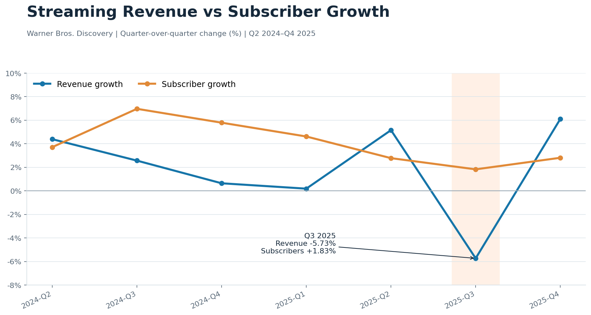
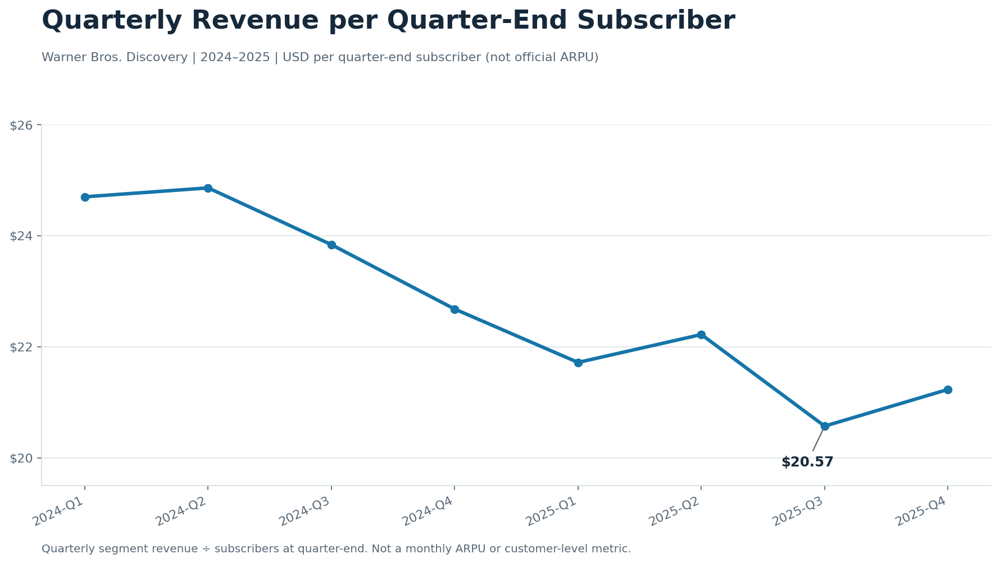
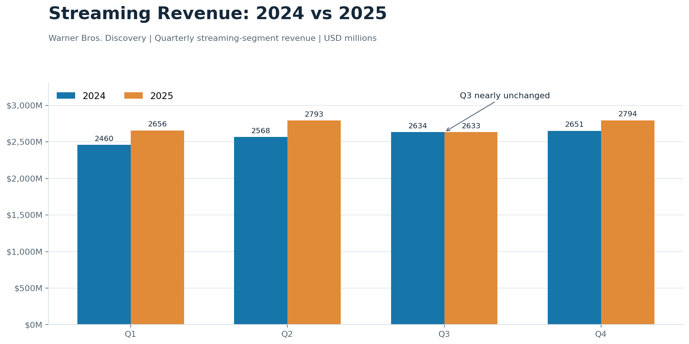

# Warner Bros. Discovery Streaming Revenue & Subscriber Analysis (2024–2025)

## About This Project

For this project, I used SQL to analyze Warner Bros. Discovery's streaming revenue and subscriber growth between 2024 and 2025.

I wanted to understand how the company's streaming business performed over time, especially whether gaining more subscribers also meant earning more revenue.

I worked with quarterly financial data and used PostgreSQL to calculate revenue changes, subscriber growth, and year-over-year performance.

## Tools Used

- **PostgreSQL 18** — Writing SQL queries and analyzing data
- **pgAdmin 4** — Importing data, running queries, and creating initial graphs
- **GitHub** — Organizing and sharing the project

## What I Analyzed

I focused on four main questions:

1. How much did streaming revenue grow or decline each quarter?
2. Did subscriber growth always lead to higher revenue?
3. How did streaming revenue in 2025 compare with 2024?
4. How much quarterly revenue was generated relative to the number of subscribers?

To answer these questions, I used SQL functions and concepts including `SELECT`, `GROUP BY`, `CASE WHEN`, `LAG()`, `ROUND()`, CTEs, and percentage calculations.

## What I Found

### 1. More subscribers didn't always mean more revenue

One of the most interesting findings was in Q3 2025.

Streaming revenue decreased by **5.73%**, even though the number of subscribers increased by **1.83%**.

This stood out to me because I expected revenue and subscriber growth to move in the same direction.

### 2. Revenue relative to subscriber count declined

I also calculated quarterly streaming revenue divided by the number of subscribers at the end of each quarter.

The ratio decreased from approximately **$24.70 in Q1 2024 to $21.23 in Q4 2025**.

This doesn't necessarily mean individual customers were spending less. It's a simple ratio based on quarterly revenue and quarter-end subscribers, not the company's official average revenue per user.

### 3. Streaming revenue was generally higher in 2025

When I compared the same quarters in 2024 and 2025, I found that revenue was higher in three of the four quarters in 2025.

Q3 was the exception, with revenue remaining almost unchanged compared with Q3 2024.

## How I Used SQL

I started by importing the dataset into PostgreSQL and checking the data.

Then I wrote queries to calculate quarterly changes, compare current and previous periods, and examine how revenue and subscriber growth related to each other.

I used `LAG()` to compare values between quarters, `CASE WHEN` to compare 2024 and 2025, and CTEs to make longer queries easier to read.

I saved the SQL scripts in the `sql` folder and the graphs in the `results` folder.

## Dataset

The project uses eight quarters of Warner Bros. Discovery streaming financial data from 2024 and 2025, collected from publicly available earnings information and SEC filings.

The dataset contains the reporting year, quarter, streaming revenue, and subscriber count.

The figures and reporting definitions still need a final check against the original reports. Since this is quarterly company-level data, the analysis focuses on business performance rather than individual customer behavior or churn.

## What I Learned

This project helped me get more comfortable writing SQL queries and understanding how different functions work together.

Before this project, I was mainly practicing SQL commands individually. Here, I got to use them to answer actual business questions.

I also learned that an increase in one metric doesn't always mean another metric will increase. Looking at revenue and subscribers together gave me a better understanding of the company's performance.

## Project Files

- `data/` — Dataset and source references
- `sql/` — SQL queries used in the analysis
- `results/` — Graphs showing the findings
- `docs/` — Additional information about the data

## How to Run This Project

This project was created using PostgreSQL 18 and pgAdmin 4.

To run the analysis:

1. Create a database named `streaming_analysis` in PostgreSQL.
2. Run `01_create_tables.sql` to create the table.
3. Import `wbd_streaming_2024_2025.csv` into the table using pgAdmin. Make sure the CSV header is enabled and leave out the automatically generated `id` column.
4. Run the SQL files in the `sql` folder to reproduce the analysis.

If the data has already been imported, there's no need to import it again.